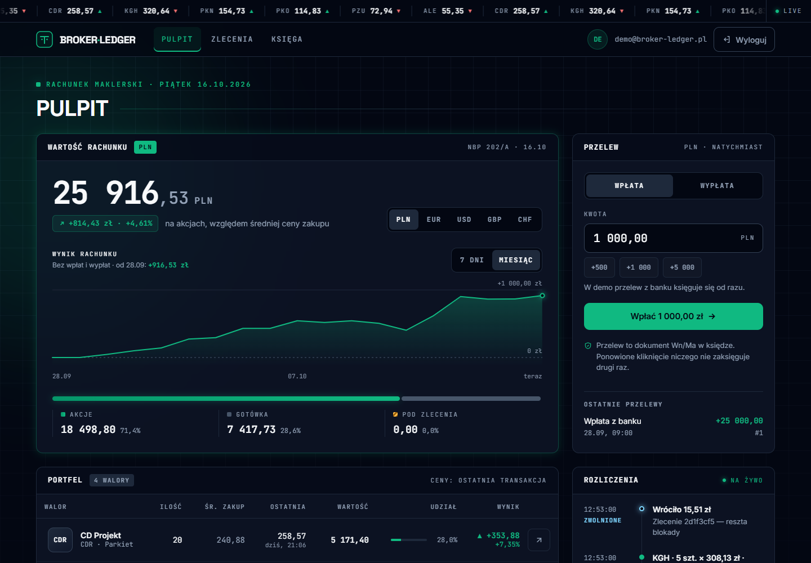
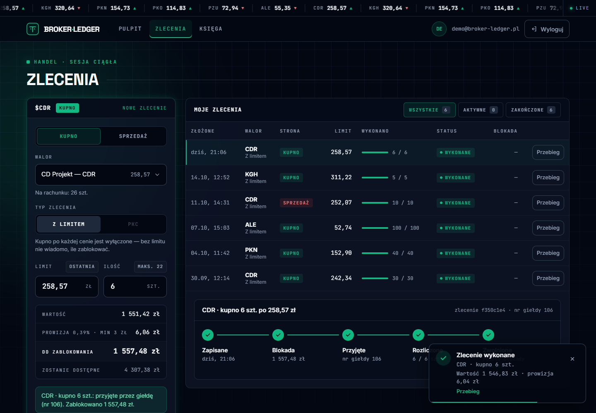
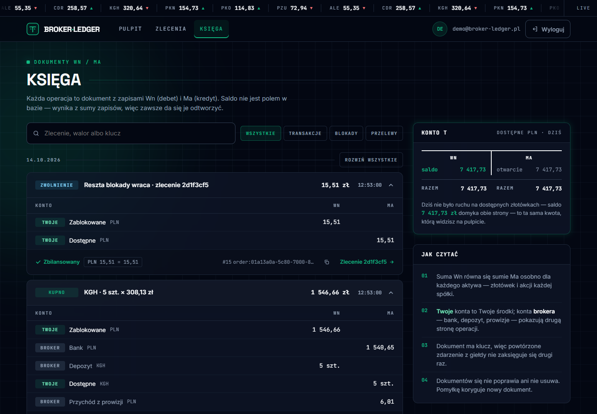

# broker-ledger

[](https://github.com/Sitkowski01/broker-ledger/actions/workflows/ci.yml)

Dom maklerski przed giełdą [Parkiet](https://github.com/Sitkowski01/parkiet-exchange): rachunki
klientów, księga podwójnego zapisu, blokada środków pod zlecenia i rozliczanie transakcji,
które giełda publikuje w Kafce.

```
klient ──► broker-ledger ──zlecenie──► Parkiet (giełda) ──transakcje──► Kafka
               ▲                                                         │
               └──────────────── rozliczenie ◄───────────────────────────┘
```

## W 30 sekund

- **Księga podwójnego zapisu** — każda operacja to dokument Wn = Ma, osobno w złotówkach i w akcjach. Saldo to suma
  zapisów; historii nie da się zmienić nawet ręcznym SQL-em (trigger), a `CHECK` nie pozwoli zejść poniżej zera.
- **Bez wyścigów** — konta blokowane `FOR NO KEY UPDATE` zawsze w kolejności id: z 20 równoległych wypłat po 10 zł
  ze 100 zł przechodzi dokładnie 10, bez zakleszczeń. Każda operacja ma klucz idempotencji.
- **Zlecenia jako saga** — blokada środków → Parkiet z `clientOrderId` → przyjęcie albo zwolnienie; timeout nie
  zwalnia pieniędzy, tylko oddaje zlecenie reconcilerowi w tle.
- **Rozliczenie z Kafki** — inbox z deduplikacją, kupno i sprzedaż z prowizją liczoną od całego wykonania, zwrot
  niewykorzystanej blokady; transakcja, która przyszła przed numerem zlecenia, czeka zamiast przepaść.
- **Portfel z księgi** — średnia cena ważona, zysk zrealizowany i niezrealizowany po ostatniej transakcji, wartość
  w walutach po kursach NBP; NBP leży → portfel otwiera się z ostatnią znaną tabelą (cache, ponowienia, bezpiecznik).
- **Na żywo** — wyzwalacze PostgreSQL wysyłają `NOTIFY` przy każdej zmianie zlecenia i salda, API rozsyła to przez
  Server-Sent Events. Działa przy kilku instancjach API; po przerwie w połączeniu klient dostaje `resync`.
- **Front w Angularze 22** (sygnały, bez zone.js) — Pulpit z wykresem wyniku bez wpłat, Zlecenia z blokadą liczoną przed
  kliknięciem i osią sagi, Księga z dokumentami Wn/Ma i kontem T. **Tryb demo bez serwera**: `cd web && npm run demo`.
- **Testy** — backend 597 (jednostkowe, własności FsCheck, architektury, integracyjne na prawdziwym PostgreSQL i Kafce,
  e2e po HTTP), front 241 (Vitest) + e2e w przeglądarce (Playwright); testy mutacyjne w CI na czterech warstwach
  (domena, baza, API, logika frontu 83%).

C# / .NET 10, ASP.NET Core (minimal API, JWT, rate limiting, SSE), EF Core + PostgreSQL, Kafka (Confluent.Kafka), xUnit, FsCheck, Testcontainers, Stryker.NET · Angular 22, RxJS, Vitest, fast-check, Playwright, StrykerJS.



<details>
<summary><b>In English</b></summary>

broker-ledger is the brokerage in front of the [Parkiet](https://github.com/Sitkowski01/parkiet-exchange) stock
exchange, written in C# / .NET 10. Client money and shares live in a double-entry ledger in PostgreSQL: every
operation is a balanced journal entry, history is append-only (enforced by a trigger), balances never go negative,
and concurrent withdrawals are serialized with row locks taken in a fixed order. Orders run as a saga — block funds,
send to the exchange with a client order id, accept or release — with a background reconciler for timeouts. Trades
come back from the exchange over Kafka (at least once) into an inbox and are settled idempotently, so each one is
booked once: purchase and sale entries with a commission charged on the whole fill, and the unused part of the block returned. The portfolio
is derived from the ledger itself (weighted average cost, realized and unrealized P&L at the last trade price) and
converted to other currencies at NBP mid rates, fetched through a cached, retrying, circuit-breaking HTTP client that
falls back to the last known table when NBP is down.
Changes reach the browser live: PostgreSQL triggers send `NOTIFY` on every order change and ledger posting, and the API
streams them as Server-Sent Events (a signal, not data — clients re-read state, and get `resync` after a lost connection).
The Angular 22 front end (signals, no zone.js) shows the account value with a performance chart excluding deposits,
an order ticket that computes the block before submitting, the saga of each order, and the double-entry ledger with a
T account; a demo build runs the whole app in the browser against a simulated broker with the same rules. Tested with unit, property-based,
architecture, integration (Testcontainers: PostgreSQL and Kafka) and end-to-end tests, plus mutation testing in CI. Front
end: Vitest, fast-check, Playwright and StrykerJS.
</details>

## Zakres

| Etap | Co | Stan |
|---|---|---|
| 1 | Szkielet: domena oddzielona od API, testy architektury, mutation testing w CI, typ `Money` | ✅ |
| 2 | Księga podwójnego zapisu: dokumenty bilansujące się w każdym aktywie, saldo z zapisów, blokady | ✅ |
| 3 | PostgreSQL (EF Core): historia nie do przepisania, idempotencja, saldo bez wyścigów i zakleszczeń, Testcontainers | ✅ |
| 4 | API: rejestracja i JWT, wpłaty i wypłaty z kluczem idempotencji, salda, historia, rate limiting, testy e2e | ✅ |
| 5 | Zlecenia (saga): blokada → Parkiet z `clientOrderId` → przyjęcie albo zwolnienie; reconciler dla timeoutów | ✅ |
| 6 | Rozliczenie transakcji z Kafki: inbox, prowizja od całego wykonania, zwolnienie reszty blokady, odporne na powtórki | ✅ |
| 7 | Portfel z księgi: pozycje, średnia cena ważona, zysk zrealizowany i niezrealizowany, wartość w walutach po kursach NBP (cache, ponowienia, bezpiecznik) | ✅ |
| 8 | Front w Angularze: logowanie, Pulpit (wartość w walutach NBP, wykres wyniku, przelewy, portfel, rozliczenia na żywo), Zlecenia, Księga; SSE z LISTEN/NOTIFY; stany (szkielety, offline, 429, powiadomienia); tryb demo; Playwright | ✅ |
| 9 | Dockerfile (bez roota) i obraz frontu (nginx), wspólny compose z giełdą, e2e całego systemu w CI, obrazy w GHCR, OpenAPI + Swagger UI, metryki Prometheusa | ✅ |

## Pieniądze

`Money` to kwota w `decimal` z walutą. Nigdy `double`: 0,1 + 0,2 w `double` to nie 0,3,
a w księdze każdy grosz musi się zgadzać.

- **Ułamek grosza to błąd**, nie coś do cichego zaokrąglenia: `Money.Pln(250.405m)` rzuca wyjątek.
- **Nie da się dodać złotówek do euro** — operacje na różnych walutach rzucają wyjątek;
  przeliczenie będzie jawne, po kursie.
- **Klasa, nie struct** — `default` dla structa dałby kwotę bez waluty.

## Księga podwójnego zapisu

Każda operacja to **dokument księgowy**: zapisy po stronie Wn (debet) i Ma (kredyt), które
w każdym aktywie sumują się do tej samej kwoty. Pieniądz nie powstaje ani nie znika — tylko
przechodzi z konta na konto. Saldo nie jest kolumną do nadpisania: liczy się je z zapisów,
więc zawsze da się pokazać, skąd się wzięło.

| Konto | Czyje | Rośnie po | Co znaczy |
|---|---|---|---|
| `ClientAvailable` | klienta | Ma | wolne środki / akcje — do wypłaty albo pod zlecenie |
| `ClientBlocked` | klienta | Ma | zablokowane pod zlecenie czekające na giełdzie |
| `Bank` | brokera | Wn | gotówka brokera w banku |
| `Depository` | brokera | Wn | akcje przechowywane za klientów |
| `FeeIncome` | brokera | Ma | przychód z prowizji |

```
wpłata 1000 zł        Wn Bank:PLN              1000  │  Ma ClientAvailable:PLN   1000
blokada pod zlecenie  Wn ClientAvailable:PLN   250   │  Ma ClientBlocked:PLN      250
wypłata 100 zł        Wn ClientAvailable:PLN   100   │  Ma Bank:PLN               100
```

- **Aktywo to waluta albo akcje spółki.** Dokument bilansuje się osobno w każdym aktywie —
  10 akcji CDR nie zrównoważy 10 zł. Gotówka liczy się do grosza, akcje w sztukach.
- **Żadne konto nie zejdzie poniżej zera** — klient nie wyda więcej, niż ma, a broker nie odda
  gotówki ani akcji, których nie trzyma. Dokument, który by to zrobił, jest odrzucany w całości.
- **Saldo to suma zapisów.** Księga trzyma je bieżąco (żeby nie przechodzić całej historii),
  ale zmienia je wyłącznie dokument — testy sprawdzają, że zgadza się z sumą zapisów.
- **Księga tylko się dopisuje** — błędu nie poprawia się edycją, tylko kolejnym dokumentem.

## Księga w PostgreSQL

```
 accounts                         journal_entries                  postings
 ─────────────────────────────    ──────────────────────────────   ─────────────────────────
 id                               id (uuid v7)                     entry_id   → journal_entries
 type, asset_kind, asset_code,    idempotency_key  UNIQUE          account_id → accounts
 client_id (NULL = broker)        description, created_at          side (Debit / Credit)
 normal_side                                                       amount  CHECK > 0
 balance  CHECK >= 0  ← projekcja
```

- **Źródłem prawdy są zapisy** (`postings`). `accounts.balance` to projekcja trzymana dla szybkości —
  zmienia się w tej samej transakcji co zapisy, a `LedgerAudit` sprawdza w czystym SQL, czy saldo
  równa się sumie zapisów i czy bilans próbny się zgadza.
- **Historii nie da się przepisać.** Trigger odrzuca `UPDATE`, `DELETE` i `TRUNCATE` na `journal_entries`
  i `postings` — także z ręcznego SQL-a. Błąd poprawia się kolejnym dokumentem.
- **Idempotencja.** Każdy dokument ma klucz od wywołującego (id przelewu, zdarzenia z giełdy).
  Ten sam klucz z tym samym dokumentem → „już zaksięgowane”, nic się nie zmienia; z innym → konflikt.
  Dokument jest wstawiany jako pierwszy, więc równoległa powtórka czeka na `UNIQUE` i nie dotyka sald.
- **Saldo bez wyścigu.** Konta dokumentu są blokowane (`SELECT balance ... FOR NO KEY UPDATE`),
  dopiero potem sprawdzane i zmieniane — do commita nikt inny ich nie ruszy. Z 20 równoległych
  wypłat po 10 zł ze 100 zł przejdzie dokładnie 10. `CHECK (balance >= 0)` to ostatnia linia obrony.
  `NO KEY UPDATE`, a nie `UPDATE`: wstawione wcześniej zapisy trzymają przez klucz obcy blokadę
  `KEY SHARE` na kontach, a `FOR UPDATE` by z nią kolidował i transakcje czekałyby na siebie nawzajem.
- **Bez zakleszczeń.** Wiersze kont są blokowane zawsze w kolejności `id`. Bez tego równoległe
  blokady i zwolnienia na tych samych dwóch kontach kończą się `40P01 deadlock detected` — test to sprawdza.
- **Nowe konta w tej samej transakcji** (w stałej kolejności) — odrzucony dokument nie zostawia pustych kont.
- **Ta sama reguła co w pamięci.** Sprawdzenie robi domena (`EnsureNoAccountGoesNegative`), więc obie
  księgi zgłaszają to samo konto: najpierw klienta, potem brokera.

## API

| Metoda | Ścieżka | Co robi |
|---|---|---|
| `POST` | `/api/auth/register` | `{email, password}` → 201 `{clientId}`; zajęty e-mail → 409 |
| `POST` | `/api/auth/login` | → 200 `{accessToken, expiresAt}` (JWT, `sub` = id klienta); złe dane → 401 |
| `GET` | `/api/me/balances` | salda klienta: na każde aktywo `available` i `blocked` |
| `POST` | `/api/me/deposits` | wpłata `{amount: "250.40", currency: "PLN"}` (symulowany przelew przychodzący) |
| `POST` | `/api/me/withdrawals` | wypłata; za mało środków → 422 z kwotą dostępną |
| `GET` | `/api/me/history?limit=20&before=…&kind=…` | dokumenty klienta od najnowszych, tylko jego zapisy, z kluczem dokumentu; kursor `nextBefore`; `kind` = `transfers` / `trades` / `blocks` |
| `GET` | `/api/me/portfolio` | pozycje, średnia cena, zysk/strata, wartość w walutach po kursach NBP — [niżej](#portfel-i-kursy-nbp) |
| `GET` | `/api/me/performance?days=30` | wynik bez wpłat i wypłat (`days` = 7 albo 30): punkt na koniec każdego dnia i „teraz” — [niżej](#wynik-w-czasie) |
| `GET` | `/api/me/events` | Server-Sent Events: `order`, `ledger`, `resync`, w ciszy `ping` — [niżej](#na-żywo-sse) |
| `GET` | `/api/me/orders`, `/api/me/orders/{id}` | zlecenia klienta (z `fundsBlocked` i `fundsReleased` — kroki sagi) |
| `GET` | `/api/market/quotes` | ostatnie ceny spółek z transakcji giełdy |

- **`Idempotency-Key` jest obowiązkowy** przy wpłacie i wypłacie. Pierwsze wykonanie → 201, powtórka
  z tym samym kluczem i treścią → 200 `alreadyPosted` (nic się nie zmienia), ten sam klucz z inną treścią → 409.
  Klucz jest zapisywany z prefiksem klienta, więc dwóch klientów może użyć tego samego.
- **Kwoty jako tekst** (`"250.40"`) — klient w JS nie zgubi groszy w `double`. Akceptowane są tylko cyfry
  i kropka: `1e3`, `-5`, `1,000.00` i ułamek grosza to 400. Waluta tylko `PLN` (Parkiet handluje
  w złotówkach) — dowolny kod z trzech liter zakładałby nowe konto banku.
- **Historia w kolejności zaksięgowania** — po numerze kolejnym (`sequence`), nie po czasie ani UUID:
  dwa dokumenty w tej samej milisekundzie mają ten sam czas, a UUID v7 w obrębie milisekundy jest losowy.
- **Błędy w formacie RFC 9457** (`application/problem+json`): 400 z polem, którego dotyczą, 401, 409, 422, 429.
  Brak środków na koncie *brokera* to błąd w kodzie, więc zostaje 500 — nie udaje „złego żądania”.
- **Hasła**: PBKDF2 (`PasswordHasher` z ASP.NET Identity). Zły e-mail i złe hasło dają tę samą odpowiedź
  w tym samym czasie (dla nieistniejącego konta też liczony jest hash), żeby nie dało się sprawdzić, kto ma konto.
- **Rate limiting**: logowanie i rejestracja — 10/min na adres IP (zgadywanie haseł), operacje na koncie —
  120/min na klienta (jeden klient nie zatka API innym). Przekroczenie → 429 z `Retry-After`.
  Za reverse proxy adres klienta bierze się z `X-Forwarded-For`, ale tylko od proxy wpisanych
  w `ReverseProxy:KnownProxies` — inaczej każdy mógłby podać dowolny adres i ominąć limit.
- **Zła konfiguracja wywala start**, a nie pierwsze żądanie: brak klucza JWT (min. 32 bajty), wystawcy
  albo dodatnich limitów → `OptionsValidationException` przy uruchomieniu — **zanim** migracje dotkną bazy.
- `/health` sprawdza połączenie z bazą — bez niej aplikacja nic nie zaksięguje.
- **Dokumentacja**: `/openapi/v1.json` (wbudowane OpenAPI z ASP.NET Core, ze schematem Bearer) i `/docs` (Swagger UI).
- **Metryki** (`/metrics`, format Prometheusa przez OpenTelemetry): czasy żądań HTTP oraz `broker_orders_total`
  (strona i stan po odpowiedzi giełdy), `broker_settled_events_total`, `broker_event_streams` (otwarte strumienie SSE).
  Eksporter Prometheusa dla OpenTelemetry jest w .NET wciąż w wersji beta — reszta pakietów jest stabilna.

## Zlecenia na giełdę (saga)

```
POST /api/me/orders  {"symbol":"CDR","side":"buy","type":"limit","limitPrice":"250.00","quantity":10}
  │
  1. zapis zlecenia (Pending)                     orders, klucz (klient, Idempotency-Key)
  2. blokada w księdze: 2500 zł + 9,75 zł prowizji  order:{id}:block
  3. POST do Parkietu z clientOrderId = id zlecenia
       201 / 200        → accepted (numer zlecenia na giełdzie)
       400 / 404        → rejected → zwolnienie blokady   order:{id}:release
       503 (1. próba)   → rejected → zwolnienie blokady
       504 / timeout    → unknown, blokada zostaje → wyjaśnia reconciler
```

- **Każdy krok jest idempotentny** — w księdze klucz, na giełdzie `clientOrderId` (Parkiet zwraca pierwotny
  wynik zamiast składać zlecenie drugi raz). Awaria w dowolnym miejscu jest do dokończenia: **reconciler**
  co kilka sekund bierze zlecenia `pending` / `unknown` i odrzucone z niezwolnioną blokadą i powtarza sagę.
- **Najpierw status, potem pieniądze.** Status zlecenia jest zapisywany przed zwolnieniem blokady — po awarii
  nigdy nie zwolnimy środków zlecenia, które mogło trafić na giełdę.
- **Licznik prób zapisany przed wysłaniem.** 503 jest odmową tylko przy pierwszej próbie — po timeoucie, awarii
  albo rozłączonym kliencie wcześniejsza próba mogła wciąż czekać w kolejce giełdy i wykonać się później,
  więc zwolnienie środków byłoby błędem. Ten sam zapis działa jak dzierżawa: gdy zlecenie chcą wysłać naraz
  żądanie klienta i reconciler, drugi przegra wyścig o wersję i niczego nie wyśle.
- **409 z giełdy** (`clientOrderId` zajęty innym zleceniem) nie zwalnia środków — zostaje do wyjaśnienia.
- **Kupno PKC nie przechodzi** — bez limitu ceny nie wiadomo, ile zablokować. Sprzedaż PKC blokuje akcje.
- **Prowizja** 0,39%, min. 3 zł, w górę do grosza; przy kupnie blokowana razem z wartością.
- **Blokada optymistyczna** (wersja zlecenia): żądanie klienta i reconciler nie nadpiszą sobie stanu.
- **Anulowanie** (`DELETE /api/me/orders/{id}`) to prośba do giełdy → `cancelrequested`. Środki zwolni
  zdarzenie anulowania z Kafki — dopiero ono mówi, ile zlecenia zdążyło się zrealizować.
- **Po przyjęciu liczy się już tylko giełda.** Transakcje, reszta PKC anulowana z braku ofert i pełna realizacja
  przychodzą jako zdarzenia z Kafki — patrz niżej.

| Odpowiedź | Kiedy |
|---|---|
| 201 | zlecenie przyjęte przez giełdę |
| 202 | giełda nie odpowiedziała — zlecenie żyje, środki zablokowane, wyjaśnia się w tle |
| 200 | powtórka żądania z tym samym `Idempotency-Key` — to samo zlecenie |
| 409 | ten sam klucz z innym zleceniem / anulowanie zlecenia, które nie jest otwarte |
| 422 | odrzucone: brak środków albo odmowa giełdy (powód w `rejectionReason`) |

## Rozliczenie transakcji (Kafka)

```
Parkiet ──exchange.events──► konsument ──► exchange_inbox ──► rozliczenie (co 250 ms) ──► księga + zlecenie
          klucz = spółka      offset po      UNIQUE (run_id,     TRADE → kupno / sprzedaż z prowizją
                              zapisie        symbol, sequence)   CANCELLED / pełne wykonanie → zwolnienie reszty
```

```
kupno 10 KGH po 140 zł (limit 150, blokada 1500 + 5,85)
  Wn ClientBlocked:PLN   1405,46  │  Ma Bank:PLN           1400,00
                                  │  Ma FeeIncome:PLN         5,46
  Wn Depository:KGH         10    │  Ma ClientAvailable:KGH     10
zwolnienie reszty
  Wn ClientBlocked:PLN    100,39  │  Ma ClientAvailable:PLN  100,39
```

- **Inbox zamiast rozliczania w konsumencie.** Konsument tylko odkłada zdarzenie do tabeli i dopiero potem
  zapisuje offset w Kafce — awaria w środku kończy się powtórką, którą `UNIQUE (run_id, symbol, sequence)`
  odrzuca, a nigdy zgubionym zdarzeniem. Wiadomość nie do przyjęcia (zepsuty JSON, wartości spoza reguł brokera)
  trafia do tabeli `exchange_dead_letters` z powodem — nie blokuje kolejki, ale też nie znika bez śladu;
  `RESTED` i nieznane typy są pomijane, więc giełda może dodać nowe zdarzenie bez psucia brokera.
- **Transakcja może przyjść przed numerem zlecenia.** Gdy żądanie do Parkietu skończyło się timeoutem, zlecenie
  jest `unknown`, a jego transakcje już płyną. Zdarzenie, które nie pasuje do żadnego zlecenia, nie jest więc od
  razu „nie nasze”: jeśli na tej spółce jest zlecenie w drodze, cała spółka czeka, aż reconciler pozna jego numer.
  Inne spółki idą dalej.
- **Kolejność w obrębie spółki.** Zdarzenia spółki są rozliczane po kolei; błąd (transakcja ponad to, co zostało
  w zleceniu, kupno drożej albo sprzedaż taniej niż limit) zatrzymuje tylko tę spółkę i trafia do logu raz —
  rozliczenie „na siłę” byłoby gorsze niż przestój. Przebieg bierze ograniczoną liczbę zdarzeń z **każdej** spółki,
  więc stojąca spółka z setkami zdarzeń w kolejce nie zabiera miejsca pozostałym.
- **Idempotencja na dwóch poziomach.** Dokument ma klucz `order:{id}:trade:{run}:{sequence}`, a zlecenie pamięta
  ostatnie rozliczone zdarzenie. Dokument jest liczony ze stanu sprzed zdarzenia, a stan zmieniany po zaksięgowaniu —
  powtórka po awarii między jednym a drugim daje identyczny dokument, więc księga odpowiada „już było”.
- **Prowizja od całego wykonania**, nie od każdej transakcji: zlecenie wykonane w 10 kawałkach płaci minimum 3 zł raz,
  więc nigdy nie przekroczy blokady. Nie więcej niż wartość — sprzedaż jednej akcji za 2 zł nie zadłuża klienta.
- **Kupno poniżej limitu** zużywa mniej, niż zablokowano; resztę zwalnia pełne wykonanie albo anulowanie.
- **Numer zlecenia giełdy** jest unikalny w spółce i przebiegu giełdy — po starcie Parkietu bez wznowienia
  numeracja rusza od nowa. Broker zapisuje przebieg (`runId` z odpowiedzi REST) razem z numerem i dopasowuje zdarzenia
  po całej trójce: spółka, przebieg, numer. Anulowanie też idzie z przebiegiem, więc nie zdejmie cudzego zlecenia.
- **Restart giełdy od zera** — giełda zapomina otwarte zlecenia, nie wysyłając anulowania. Broker zamyka je przy
  pierwszym zdarzeniu nowego przebiegu na spółce i zwalnia resztę blokady. Wcześniej nie wolno: Kafka trzyma kolejność
  w spółce (klucz = spółka, outbox Parkietu wysyła po kolei), więc dopiero wtedy wiadomo, że żadna transakcja starego
  przebiegu już nie dojdzie. Ograniczenia: zamknięcie czeka na transakcję albo anulowanie na tej spółce (wejście
  zlecenia do arkusza broker w Kafce pomija); numery przebiegów muszą rosnąć, więc bazy
  Parkietu nie czyści się osobno od bazy brokera; zlecenia sprzed zapisu przebiegu nie są zamykane automatycznie.
- Bez `ExchangeEvents:BootstrapServers` broker działa bez Kafki (np. lokalnie bez giełdy) — zlecenia czekają.

Zlecenie w API pokazuje wykonanie: `filledQuantity`, `filledValue`, `commission`, a status przechodzi
`accepted` → `filled` albo `cancelled`.

## Portfel i kursy NBP

`GET /api/me/portfolio` — otwarte pozycje wycenione po ostatniej transakcji, zamknięte z wynikiem, sumy
i wartość całego rachunku w EUR / USD / GBP / CHF po kursie średnim NBP.

```
{"positions":[{"symbol":"CDR","quantity":10,"averageCost":"100.39","costBasis":"1003.90","lastPrice":"110.50",
   "marketValue":"1105.00","unrealizedPnl":"101.10","returnPercent":"10.07","realizedPnl":"0.00", ...}],
 "closed":[{"symbol":"PKO","realizedPnl":"34.00"}],
 "summary":{"cash":"9030.10","sharesValue":"1105.00","unrealizedPnl":"101.10","realizedPnl":"34.00","totalValue":"10135.10", ...},
 "totalValueIn":[{"currency":"EUR","amount":"2384.73"}, ...],
 "rates":{"source":"NBP","table":"198/A/NBP/2026","effectiveDate":"2026-10-09","stale":false,"mid":{"EUR":"4.25", ...}}}
```

- **Portfel liczony z księgi**, bez osobnej tabeli pozycji, która mogłaby się z nią rozjechać. Liczy się zmiana
  akcji i gotówki klienta w dokumencie, a nie jego opis: kupno to „akcji przybyło, gotówki ubyło”, sprzedaż
  odwrotnie, blokada pod zlecenie niczego nie zmienia (akcje zablokowane pod sprzedaż wciąż są klienta).
- **Średnia cena ważona** z prowizją. Sprzedaż zdejmuje z kosztu ułamek równy ułamkowi sprzedanych akcji
  (do grosza), a sprzedaż wszystkiego — cały koszt, więc na pustej pozycji nie zostają grosze z zaokrągleń.
  Test własności sprawdza na losowych ciągach, że wynik zrealizowany + koszt pozostałych = otrzymane − zapłacone + ten koszt.
- **Ostatnia cena ze skrzynki zdarzeń.** Broker i tak dostaje z Kafki wszystkie transakcje giełdy, więc nie potrzebuje
  osobnego strumienia notowań: `DISTINCT ON (symbol)` po indeksie częściowym `(symbol, id DESC) WHERE type = 'TRADE'`.
  Spółka bez żadnej transakcji jest wyceniana po koszcie. Akcje przeniesione od innego biura mają koszt 0.
- **Kursy NBP z pamięci.** Tabela A zmienia się raz dziennie, więc trzymamy ją godzinę i nie pytamy NBP przy każdym
  otwarciu portfela; równoległe żądania czekają na jedno zapytanie. HttpClient ma potok odporności
  (`Microsoft.Extensions.Http.Resilience`): limit czasu każdej próby, dwa ponowienia z wykładniczą przerwą przy 5xx
  i timeoucie, bezpiecznik. Inaczej niż przy giełdzie ponowienia są tu bezpieczne — GET niczego nie zmienia.
- **NBP leży → portfel i tak się otwiera.** Z ostatnią znaną tabelą oznaczoną `"stale": true` albo — gdy żadnej
  jeszcze nie było — bez przeliczeń (`"rates": null`). Po nieudanej próbie przez minutę nie pytamy wcale, żeby
  każde żądanie nie czekało na kolejny timeout. NBP nie wchodzi do `/health`: bez kursów broker działa.

## Wynik w czasie

`GET /api/me/performance` liczy wynik rachunku **bez wpłat i wypłat**: wartość (gotówka + akcje po cenie w danej chwili)
minus wpłacone netto. Punkt na koniec każdego dnia w strefie giełdy i ostatni — „teraz”, więc wykres kończy się na wartości
z Pulpitu.

- Z księgi, bez osobnej tabeli wyników. Dokument, który zmienia gotówkę, a nie rusza akcji, to przepływ z zewnątrz
  (wpłata, wypłata) — zmienia „wpłacone”, nie wynik. Blokada pod zlecenie przesuwa między kontami klienta i sama znika.
- Ceny w chwilach z przeszłości: jedno zapytanie `unnest(spółki) × unnest(chwile)`, a każda para to jeden skok po indeksie
  `(symbol, received_at)` w skrzynce zdarzeń giełdy — bez czytania całej historii transakcji.
- Właściwość sprawdzana przez FsCheck: same wpłaty i wypłaty nigdy nie dają wyniku innego niż zero.

## Na żywo (SSE)

```
zmiana zlecenia / zapis w księdze ──trigger──► pg_notify('client_events') ──LISTEN──► API ──SSE──► przeglądarka
     (HTTP, reconciler, rozliczenie z Kafki)                                       (każda instancja)
```

- **Sygnał z bazy, nie z kodu C#**: zmiany robią trzy miejsca (żądanie HTTP, reconciler, rozliczenie z Kafki) i może być kilka
  instancji API. Wyzwalacz widzi wszystkie. `NOTIFY` idzie przy `COMMIT` (wycofana transakcja nic nie wyśle), a identyczne
  powiadomienia z jednej transakcji Postgres skleja — dokument z pięcioma zapisami to jeden sygnał.
- **Sygnał bez kwot** — tylko „u ciebie zmieniło się zlecenie X / księga”. Front po nim pyta API o stan, więc zgubiony albo
  podwójny sygnał niczego nie psuje. Po zerwaniu nasłuchu API wysyła wszystkim `resync` (sprawdzone testem z
  `pg_terminate_backend`), a front po ponownym połączeniu też czyta wszystko od nowa.
- `GET /api/me/events`: najpierw `ready`, w ciszy `ping` co 15 s (proxy nie zamknie połączenia), wolny klient traci najstarsze
  sygnały z bufora zamiast blokować pozostałych.

## Front (Angular)

| | |
|---|---|
|  |  |

Angular 22 (komponenty standalone, sygnały, `httpResource`, bez zone.js), w katalogu `web/`. Wygląd z makiet w stylu
terminala giełdowego, ciemny motyw, układ na telefon (karty zamiast tabel, oś sagi pionowo).

- **Pulpit** — wartość rachunku w PLN i w walutach NBP, struktura (akcje, gotówka, pod zleceniami), wykres wyniku bez wpłat,
  przelewy, portfel, panel Rozliczenia na żywo. Pusty rachunek mówi, od czego zacząć.
- **Zlecenia** — formularz liczy blokadę i prowizję tymi samymi wzorami co domena (na groszach), maks. ilość, „Ostatnia”
  cena; kupno PKC wyłączone z wyjaśnieniem. Lista z filtrem i anulowaniem z potwierdzeniem, oś sagi z pól zlecenia
  (zapis → blokada → giełda → rozliczenie → zwolnienie reszty).
- **Księga** — dokumenty Wn/Ma po dniach, bilans per aktywo, klucz dokumentu, filtr rodzaju po stronie API, kursor
  „Wczytaj starsze”, konto T dostępnych złotówek za dziś (otwarcie liczone wstecz z bieżącego salda).

Decyzje, które łatwo przeoczyć:

- **Klucz idempotencji na próbę**, nie na kliknięcie: ponowienie po zerwanym połączeniu wysyła ten sam klucz (API zwróci to
  samo zlecenie), zmiana pola w formularzu — nowy.
- **Ostatnia dobra odpowiedź** (`linkedSignal`): nieudane odświeżenie nie kasuje ekranu — inaczej po przelewie i 429 przy
  odświeżeniu znikałoby potwierdzenie razem z kluczem, a klient kliknąłby jeszcze raz.
- **SSE przez `HttpClient` z `fetch`**, nie `EventSource` — ten nie wyśle nagłówka `Authorization`. Ekrany odświeżają się po
  sygnale najwyżej raz na okno (Zlecenia 1 s, Pulpit i Księga 4 s), bo limit API to 120 zapytań na minutę na klienta;
  bez strumienia Zlecenia wracają do odpytywania (3 s przy sadze w ruchu, 15 s przy zleceniu czekającym, nic w ukrytej karcie).
- **Stany**: szkielety zamiast „Wczytywanie”, pasek „Brak połączenia” z czasem danych i „Spróbuj teraz”, 429 z odliczaniem
  `Retry-After` (formularz zostaje wypełniony), powiadomienia o transakcjach i wykonaniu zlecenia.
- **Ekrany nie importują się nawzajem** — pilnuje tego dependency-cruiser w CI (wspólne rzeczy w `core` i `shared`).

**Tryb demo** (`npm run demo`, build `npm run build:demo`) — ten sam front bez serwera: ostatni interceptor HTTP odpowiada
zamiast sieci, a sygnały na żywo idą prosto z symulatora brokera w przeglądarce. Symulator ma te same zasady co serwer
(blokada, prowizja od całego wykonania, saga, dokumenty Wn/Ma jak `JournalEntries`), a ceny startowe są nagrane z sesji
z botami Parkietu. Kod demo jest w `web/src/app/demo/` i wchodzi do builda tylko w konfiguracji `demo`.

## Uruchomienie

Całość w kontenerach (broker, front, giełda Parkiet z botami, Kafka, bazy):

```bash
docker compose --profile app up --build
# front    http://localhost:8093   (nowe konto, wpłata, zlecenie — boty Parkietu je wykonają)
# API      http://localhost:8091/docs   (Swagger UI; opis: /openapi/v1.json, metryki: /metrics)
# giełda   http://localhost:8090   (terminal Parkietu)
```

Obrazy `broker-ledger-api` i `broker-ledger-web` CI publikuje w GHCR po zielonych testach i e2e całego systemu.

Praca nad API:

```bash
docker compose up -d                          # PostgreSQL na porcie 5434
# zlecenia ida do gieldy Parkiet: Exchange:BaseUrl (domyslnie http://localhost:8090/),
# transakcje przychodza z jej Kafki: ExchangeEvents:BootstrapServers (w Development localhost:9092)
dotnet run --project src/BrokerLedger.Api     # http://localhost:8091, migracje przy starcie (Development)

curl -X POST localhost:8091/api/auth/register -H 'Content-Type: application/json' \
     -d '{"email":"jan@example.com","password":"correct horse battery"}'
TOKEN=$(curl -s -X POST localhost:8091/api/auth/login -H 'Content-Type: application/json' \
     -d '{"email":"jan@example.com","password":"correct horse battery"}' | jq -r .accessToken)

curl -X POST localhost:8091/api/me/deposits -H "Authorization: Bearer $TOKEN" \
     -H 'Idempotency-Key: przelew-1' -H 'Content-Type: application/json' -d '{"amount":"1000.00","currency":"PLN"}'
curl localhost:8091/api/me/balances -H "Authorization: Bearer $TOKEN"
# [{"asset":"PLN","kind":"Cash","available":"1000.00","blocked":"0.00"}]
```

Klucz JWT w `appsettings.Development.json` służy tylko do lokalnego uruchomienia; poza nim
ustawia się go zmienną `Jwt__SigningKey`.

Front (Node 24):

```bash
cd web && npm ci
npm start           # http://localhost:4200, /api przez proxy do API na 8091
npm run demo        # bez serwera i bez Dockera: symulator brokera w przeglądarce, dowolny e-mail i hasło
```

## Testy

```bash
dotnet test                   # wszystko; integracyjne potrzebuja Dockera (Testcontainers)
dotnet tool restore
dotnet stryker                # testy mutacyjne domeny, próg 80%
dotnet stryker -f stryker-infrastructure.json   # testy mutacyjne warstwy bazy (kilka minut)
dotnet stryker -f stryker-api.json              # testy mutacyjne API na testach e2e
```

Front (w `web/`):

```bash
npx ng test --watch=false    # jednostkowe i komponentów (Vitest)
npm run arch                 # architektura frontu (dependency-cruiser)
npm run stryker              # testy mutacyjne logiki frontu, próg 80%
npm run e2e                  # Playwright na trybie demo (sam stawia serwer)
E2E_LIVE=1 npm run e2e       # + prawdziwe API (8091) z PostgreSQL, Kafką i giełdą Parkiet
```

| Rodzaj | Co sprawdza |
|---|---|
| Jednostkowe | `Money`, konta, zapisy, dokumenty, księga: bilansowanie, brak środków, atomowość dokumentu |
| Własności (FsCheck) | losowe ciągi wpłat, wypłat, blokad i zwolnień kontra prosty model; po każdym kroku bilans próbny i brak ujemnych sald |
| Architektura | domena nie zależy od ASP.NET, EF Core, HTTP ani Kafki (NetArchTest) |
| Architektura (baza) | warstwa bazy nie zna warstwy web i nie wystawia swoich typów — reszta widzi tylko `ILedgerStore` |
| Integracyjne | prawdziwy PostgreSQL w Dockerze, osobna baza na test (klon szablonu po migracjach): idempotencja, wycofanie odrzuconego dokumentu, trigger i `CHECK`-i, audyt wykrywa ręczną zmianę salda |
| Współbieżność | 20 równoległych wypłat, 20 powtórek jednego klucza, przeciwne ruchy na tych samych kontach (bez zakleszczeń) |
| Różnicowe | ten sam losowy ciąg operacji na księdze w pamięci i w PostgreSQL — te same decyzje i salda |
| E2E (API) | cała aplikacja (`WebApplicationFactory`) na prawdziwym PostgreSQL: rejestracja i logowanie, sfałszowane i wygasłe tokeny, wpłata → wypłata → salda → historia ze stronicowaniem, powtórki i konflikty kluczy, walidacja, 10 równoległych wypłat po HTTP, limity 429, start z błędną konfiguracją, health bez bazy |
| Architektura (API) | warstwa web nie zależy od EF Core ani Npgsql — rozmawia z księgą tylko przez porty domeny |
| Saga (jednostkowe) | każda ścieżka zlecenia na atrapach: brak środków, odmowa, 503 przy pierwszej próbie i po timeoucie, awaria przed zapisem blokady i przed zwolnieniem — dokończona bez dublowania, nieaktualna kopia nie nadpisze stanu |
| E2E zleceń | HTTP → księga w PostgreSQL → Parkiet w pamięci z awariami na życzenie: 504 mimo przyjęcia, cisza, błąd sieci → reconciler wyjaśnia, na giełdzie zawsze jedno zlecenie |
| Klient giełdy | mapowanie kodów HTTP Parkietu na decyzje sagi, format zlecenia, zepsuty JSON, anulowanie przez wołającego ≠ timeout |
| Rozliczenie (jednostkowe) | częściowe i pełne wykonanie, anulowanie, transakcja między dwoma klientami brokera, zdarzenie nie do tego zlecenia, czekanie na zlecenie w drodze, awaria po zaksięgowaniu i przed zwolnieniem — dokończona powtórką |
| Rozliczenie (FsCheck) | losowy podział zlecenia na transakcje po losowych cenach, czasem anulowane: blokada zawsze kończy na zerze, prowizja raz od całości, gotówka i akcje się zgadzają |
| Kafka (integracyjne) | prawdziwa Kafka i PostgreSQL w Dockerze: format zdarzeń Parkietu, powtórki, zepsute wiadomości, offset po restarcie konsumenta, awaria bazy ponawiana |
| E2E rozliczenia | HTTP → Parkiet w pamięci → zdarzenie na Kafce → skrzynka → księga → salda przez HTTP; także transakcja dla zlecenia `unknown`, która czeka na reconciler, i restart giełdy od zera, po którym wraca reszta blokady |
| Portfel (jednostkowe + FsCheck) | średnia z prowizją, częściowa i pełna sprzedaż, prowizja równa wartości, blokady bez wpływu, akcje z kosztem 0; losowe ciągi kupna i sprzedaży nie gubią ani nie dorabiają grosza |
| Kursy NBP | format tabeli A i odrzucanie zepsutych odpowiedzi; pamięć, przeterminowana tabela, przerwa po awarii, jedno zapytanie dla wielu żądań; prawdziwy potok odporności: 5xx ponawiane, zawieszona próba ucięta, 404 bez ponowień |
| E2E portfela | HTTP → księga i skrzynka w PostgreSQL → atrapa NBP: wycena, waluty, NBP leży, tabela przeterminowana; pełna droga zlecenie → Kafka → rozliczenie → portfel wyceniony po późniejszej cudzej transakcji |
| Sygnały na żywo (integracyjne) | wyzwalacze NOTIFY na prawdziwym PostgreSQL: dokument to jeden sygnał, cudze nie docierają, po `pg_terminate_backend` nasłuchu jest `resync`; strumień SSE po HTTP: `ready`, saga zlecenia, `ping` |
| Wynik w czasie | FsCheck: same wpłaty/wypłaty dają wynik 0; kupno kosztuje tylko prowizję; koniec dnia w Warszawie także przy zmianie czasu; cena w chwili z przeszłości w PostgreSQL |
| Front (Vitest) | rachunki formularza zlecenia (fast-check: maks. ilość nigdy ponad blokadę), modele ekranów, komponenty na atrapie API (`HttpTestingController`), strumień SSE kawałkami, symulator demo |
| Front e2e (Playwright) | tryb demo: pełna ścieżka kupna (saga, powiadomienia, księga), odmowa przed wysłaniem, telefon bez poziomego przewijania; live: nowy klient, wpłata, zlecenie na Parkiecie, wpłata z innego miejsca widoczna bez odświeżania (SSE) |
| Architektura (front) | ekrany nie importują się nawzajem, `core` nie zna widoków (dependency-cruiser) |
| Mutacyjne | Stryker psuje kod i sprawdza, czy testy to wykryją — osobno domena, warstwa bazy, API i logika frontu |

Na Windowsie z zainstalowanym Visual Studio 2022 Stryker bierze jego starszy MSBuild, który nie zna
.NET 10 — wtedy `dotnet stryker --msbuild-path "C:/Program Files/dotnet/sdk/<wersja>/MSBuild.dll"`.

## Licencja

MIT — [LICENSE](LICENSE).
